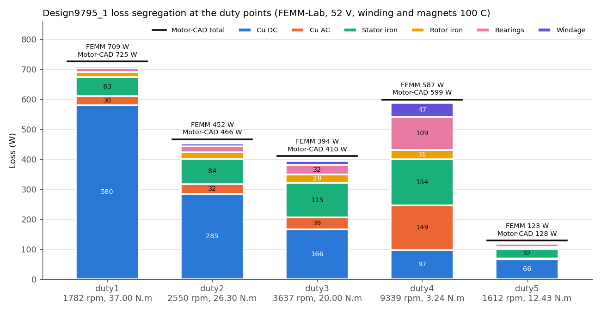

# Electromagnetic load points: loss segregation and causes

Design9795_1 copper (12-slot / 10-pole spoke ferrite, delta, 52 V, MI 0.95, winding and magnets 100 C). Loss values: FEMM-Lab (lab_model v3, 3 skew slices) from `losses_9795.json`; Motor-CAD total for comparison. Field figures: FEMM 2D, unskewed centre slice, 24 rotor positions per electrical period (3 deg mech).

| point | rpm | N.m | f_el Hz | I line A rms | id/iq A pk | V pk (max 49.4) | Cu DC | Cu AC | stator Fe | rotor Fe | bearings | windage | total | Motor-CAD | dominant |
|---|---|---|---|---|---|---|---|---|---|---|---|---|---|---|---|
| duty1 | 1782 | 37.0 | 148 | 293 | -70/229 | 28.1 | 580 | 30 | 63 | 18 | 13 | 5 | **709** | 725 | copper (DC+AC) 610 W |
| duty2 | 2550 | 26.3 | 212 | 206 | -34/164 | 36.2 | 285 | 32 | 84 | 22 | 20 | 9 | **452** | 466 | copper (DC+AC) 317 W |
| duty3 | 3637 | 20.0 | 303 | 157 | -23/126 | 47.6 | 166 | 39 | 115 | 28 | 32 | 14 | **394** | 410 | copper (DC+AC) 205 W |
| duty4 | 9339 | 3.24 | 778 | 120 | -96/21 | 49.2 | 97 | 149 | 154 | 31 | 109 | 47 | **587** | 599 | copper (DC+AC) 246 W |
| duty5 | 1612 | 12.43 | 134 | 99 | -8/80 | 19.7 | 66 | 3 | 32 | 6 | 11 | 5 | **123** | 128 | copper (DC+AC) 69 W |

## duty1: 1782 rpm, 37.0 N.m, dominant copper (DC+AC)

Low speed, high torque: 293 A rms line for 37 N.m at 148 Hz with plenty of voltage margin (28.1 of 49.4 V). The id of -70 A pk is MTPA (reluctance torque of the spoke rotor), not field weakening. Copper loss goes with I^2: Cu DC 580 W is 82 % of the total. Cu AC stays 30 W because f is low (skin depth 6.2 mm vs wire 2.95 mm, d/delta 0.47), even though the slot field is the highest of all points. Iron is 81 W (tooth B up to 1.97 T) at only 148 Hz.

**CFD consequence.** Heat is in the winding (580 W DC + 30 W AC, slot and end-winding): hottest spot is the coil / end winding; stator iron 63 W and rotor 18 W are minor.

**EM levers.** Copper area / lower resistance (fill factor, shorter end turns), magnet grade or temperature (hotter ferrite = less Br = more current), MTPA is already least-current.

## duty2: 2550 rpm, 26.3 N.m, dominant copper (DC+AC)

206 A rms line at 212 Hz (36.2 of 49.4 V, id -34 A pk, mostly MTPA). Cu DC 285 W falls with I^2 as torque drops while iron rises with frequency (106 W); Cu AC 32 W grows with f^2 (d/delta 0.57).

**CFD consequence.** Winding still dominant (317 W) but stator iron (84 W) is significant: heat split winding > stator teeth/yoke.

**EM levers.** As duty1; thinner lamination or a lower-loss grade starts to pay off.

## duty3: 3637 rpm, 20.0 N.m, dominant copper (DC+AC)

157 A rms line at 303 Hz (47.6 of 49.4 V, id -23 A pk, mostly MTPA). Cu DC 166 W falls with I^2 as torque drops while iron rises with frequency (143 W); Cu AC 39 W grows with f^2 (d/delta 0.68).

**CFD consequence.** Winding 205 W, stator iron 115 W, mechanical 46 W: heat more evenly split; teeth and yoke start to matter for the housing path.

**EM levers.** Voltage margin is nearly used (47.6 V): battery sag pushes toward field weakening and more current.

## duty4: 9339 rpm, 3.24 N.m, dominant copper (DC+AC)

Top speed, 778 Hz, at the voltage limit (49.2 of 49.4 V pk): holding 3.24 N.m needs id -96 A pk (98 % of the current is field-weakening d-axis current; with id = 0 the back-EMF would need 99 V). So 120 A rms line flows for only 3.24 N.m (pf 0.48), and its slot leakage field at 778 Hz gives Cu AC 149 W, more than the DC copper (97 W): skin depth 2.7 mm is now about the wire diameter 2.95 mm (d/delta 1.09). Iron (154 + 31 W) is high because loss/kg scales with f (hysteresis) and f^2 (eddy) even though the d-axis current cuts the main flux by 51 %; tooth-tip B still peaks at 1.91 T. Bearings + windage (156 W) are 27 % of the total.

**CFD consequence.** Heat moves out of the copper DC term: AC copper (149 W) sits in the slot (worst near the slot opening, where leakage B is highest), stator iron 154 W in teeth/tips and yoke, rotor iron 31 W plus bearings 109 W and windage 47 W heat the rotor, shaft and bearings with poor cooling paths.

**EM levers.** Cu AC: stranded/litz or smaller parallel strands (loss ~ d^4 per strand), keep conductors away from the slot opening, deeper or closed slot tips; iron: 0.2-0.27 mm lamination or better grade cuts eddy (~ t^2); voltage: higher DC link or less battery sag (48 V costs +38 W, 44 V +81 W, nearly all copper); control: loss-minimising instead of MTPA trades a little copper for iron.

## duty5: 1612 rpm, 12.43 N.m, dominant copper (DC+AC)

Light load at low speed (99 A rms, 134 Hz): every term is small. Cu DC 66 W still dominates; iron 38 W is mostly magnet-field hysteresis at 134 Hz; Cu AC 3 W (d/delta 0.45).

**CFD consequence.** Low total (123 W); winding first, stator iron second. Thermally benign.

**EM levers.** No action needed on the EM side.

## Figures and animations

- `flux_duty1.mp4`, `flux_duty4.mp4`: |B| (0-2 T) and flux lines over one electrical period, rotor turning, phase-current time marker.
- `dq_limits.png`: d-q plane with the voltage ellipse at each speed and the current limit. duty1 is current/torque driven; duty4 sits on the voltage ellipse.
- `iron_density_duty1_vs_duty4.png`: iron loss density (W/kg) per element from the full-cycle B waveforms with the Motor-CAD Steinmetz model.
- `slot_leakage_duty1_vs_duty4.mp4`: slot leakage B at the wires over the cycle (AC copper loss ~ f^2 B^2).
- `waveforms_spectrum_duty1_vs_duty4.png`: tooth, tip, yoke and rotor B waveforms with their harmonic spectra.

## Check: unskewed field post-processing vs the loss table

| point | stator Fe | rotor Fe | Cu AC | table stator / rotor / AC |
|---|---|---|---|---|
| duty1 | 63 | 16 | 30 | 63 / 18 / 30 |
| duty4 | 156 | 32 | 149 | 154 / 31 / 149 |

The table uses 3 skew slices and an interpolated d-q map; the figures use the centre slice only, so small differences are expected.
